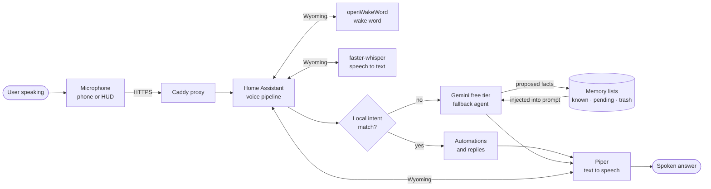

# Local Voice Assistant: Case Study

> A Brazilian Portuguese voice assistant for the home that listens, speaks, and remembers across conversations, running on the owner's own machine with no subscription.
> **Source code is private.** This repository documents the project; a live walkthrough is available on request.

**Stack**: Home Assistant · Docker Compose · Wyoming protocol · faster-whisper · Piper · openWakeWord · Gemini (free tier, fallback only) · Caddy · Jinja2 · Python · vanilla HTML/CSS/JS

**Status**: personal project, built August to September 2026. It runs at home for my own use and is not offered to anyone else. Air conditioning, TV, calendar, and email are wired in but still waiting on device data; a custom Portuguese wake word model is not trained yet.

## The problem

Commercial voice assistants send every word to the cloud, handle Brazilian Portuguese poorly, and push you toward a monthly plan. I wanted an assistant that speaks natural Portuguese, keeps audio inside the house, remembers what I tell it between conversations, and costs nothing to run.

## The solution

A self-hosted voice pipeline built on Home Assistant, where speech recognition, speech synthesis, and wake word detection all run locally in containers. Most commands are resolved by Home Assistant's local intent engine with no API call at all. Only open-ended conversation falls through to a language model on its free tier, which keeps the quota from running out.

## What I built

- **Local voice pipeline**: wake word, speech to text, intent handling, and text to speech, all in Brazilian Portuguese and all on the local machine, wired together over the Wyoming protocol.
- **Local first intent routing**: custom sentence files resolve everyday commands locally (including with "Jarvis," in front of the question), so the language model is only a safety net.
- **Long term memory**: facts the user dictates go straight into memory; facts the assistant infers are proposed inside its normal answer (no extra model call) and wait in an approval queue. Forgotten facts go to a recoverable trash list.
- **Nightly memory review**: once a day at 3:00 a.m. the assistant rereads its memory and flags duplicates, contradictions, and expired facts. It points them out and the owner decides; it never deletes on its own.
- **Natural Portuguese speech**: a template library turns times, dates, temperatures, percentages, and currency into spoken words before they reach the voice engine, with Portuguese grammar rules such as the feminine gender of hours. A lint script rejects text the voice would mispronounce.
- **Custom HUD**: a standalone control panel of about 2,000 lines with no framework, with an animated core that reacts to the real voice, a continuous microphone, text chat, a voice picker, and a memory tab.
- **Daily routines**: morning briefing, end of day summary, and a rain alert on the day of a planned event.
- **Device tolerant automations**: air conditioning, TV, calendar, and email logic works today with zero devices paired and starts acting the day each one is connected. Nothing points to a hardcoded entity name.
- **Settings on screen**: every number the owner might want to tune lives in a settings panel, not in code.
- **Health check**: one script runs 105 checks across the whole stack and is the contract after any change.

## Architecture

- **Five containers, one Compose file**: Home Assistant, faster-whisper, Piper, openWakeWord, and a Caddy HTTPS proxy. Every image version is pinned, and third party integrations come from fixed, versioned releases instead of runtime downloads, so the setup is reproducible.
- **Memory without extra infrastructure**: Home Assistant renders the agent prompt as a Jinja template with access to the home state, so the current memory is injected on every question with no third party integration and no extra server.
- **Everything as files**: configuration that only lives in the UI is lost on migration, so setup steps are Python scripts that apply it through the Home Assistant API.
- **Portable by design**: nothing is tied to macOS; the stack is meant to move to a Linux mini PC.

## Technical challenges

- **Letting the model delete memory was wrong 2 times out of 3.** With a deliberately messy memory, asking the model "which facts should I delete?" got 1 of 3 right, while asking "what is wrong here?" got 3 of 3. The nightly review now only reports, and the human decides.
- **Testing the wrong path made everything look broken.** Calling the conversation API with the language model agent skips the local intent stage, so local phrases appear to fail when they work. Local first routing is a pipeline setting, not an agent setting, and tests now target the local agent.
- **Automations silently disappearing.** An automation that references a missing entity becomes invalid and drops out of the UI. All device logic now resolves entities at runtime by integration.
- **"Nobody home" is not "home is empty".** A zero count of people at home also covers "location unknown", so a dedicated sensor separates the two cases.
- **Microphone access needs HTTPS.** Browsers only allow the microphone in a secure context, so a Caddy proxy with a locally generated certificate fronts the panel.
- **Portuguese grammar in speech.** Raw numbers were read digit by digit, and hours in Portuguese take feminine articles with exceptions for noon and midnight, so all spoken numbers go through dedicated macros.
- **Silent config failures.** Duplicate YAML keys and a configuration block the platform stopped honoring failed without errors; both are now caught by the health check or replaced by scripts.

## Scale

- ~5,000 lines of YAML (automations, intents, sentences, dashboards)
- ~3,300 lines of Python (setup, test, and lint scripts)
- ~2,000 lines of HTML/CSS/JS (the HUD)
- ~1,100 lines of shell (health check, backup, certificates, voices)
- 105 automated health checks
- 43 commits

## My role

Solo project, built with AI coding assistance. I defined the product, chose the architecture and the local first approach, designed the memory model, wrote the automations, scripts, and HUD, and measured each decision documented above.

---
Built by **Victor Sestrem** · [LinkedIn](https://www.linkedin.com/in/victor-sestrem/) · victor-sestrem@hotmail.com
